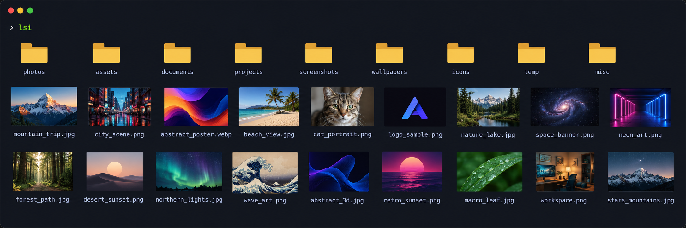

# kitty-lsi

**An `ls` with real image thumbnails, right inside Kitty.**

`lsi` prints a thumbnail grid with filenames and returns your prompt.
`lsi -l` prints rows with thumbnails and file metadata; `lli` is the same command
in long mode. No interactive file browser, Kitty fork, or replacement of `ls`.

Directories come first by default, alphabetically within each group, and use a
neutral **folder icon rendered inline**. The icon is generated by the program,
not loaded from an OS theme; no eza/lsd integration or icon font is required.
Use `lsi --sort=name` for global alphabetical
order with directories and files mixed. `--group-directories-first` explicitly
keeps grouping with a selected sort; `-U` / `--sort=none` preserve enumeration order
unless grouping is explicitly requested.

The implementation is **Rust**, in [`rust/`](rust/README.md).

## Visual examples

Example of the grid view:



## Run the local standalone binary

```sh
./rust/target/x86_64-unknown-linux-musl/release/lsi ~/Pictures
./rust/target/x86_64-unknown-linux-musl/release/lsi -lah ~/Pictures
```

The Linux x86-64 release is a **single statically linked executable**. It needs
no Python, pip, Cargo, ImageMagick, `icat`, or system image-codec libraries at
runtime. Kitty itself is needed to **display** the images. Outside Kitty and
when piped/redirected, the program prints plain text.

**No binary release has been published yet.** The source repository is
[serber-info/kitty-lsi](https://github.com/serber-info/kitty-lsi).
GitHub Releases and AUR `lsi-bin` / `lsi` are the planned distribution channels,
not existing downloads or packages.
Names must be checked before publication. `lsi-bin` will install the prebuilt
binary; the source package will need a Rust build toolchain **at build time**.

The standalone archive contains one executable, `lsi`, plus an `lli -> lsi`
shortcut. AUR and Debian packages install only `lsi`, avoiding a conflict with
LLVM's `/usr/bin/lli`. For the short command in Bash/Zsh, define:

```sh
alias lli='lsi -l'
```

Then `lli -h` is exactly `lsi -lh`. Add the alias to your own shell configuration
if you want it to persist; installers never modify shell profiles or `kitty.conf`.

Maintainer: **serber-info**. General support belongs in
[GitHub Issues](https://github.com/serber-info/kitty-lsi/issues).
The GitHub noreply address in Git/package metadata protects the maintainer's
personal email and is not a support mailbox. See [SECURITY.md](SECURITY.md) for
private vulnerability reporting.

## Usage

```sh
lsi                         # Grid in the current directory
lsi ~/Pictures              # Another directory
lsi -l                      # Thumbnail rows + file metadata
lli -h                      # Exactly lsi -lh
lsi -lah                    # Long format, hidden files, readable sizes
lsi -A                      # Hidden files, without . and ..
lsi -lSh                    # Largest files first
lsi -tr                     # Oldest modification first
lsi -v                      # photo2 before photo10
lsi -1                      # One thumbnail per row, without long metadata
lsi --width 24 --height 6    # Thumbnail area in terminal cells
lsi -- *.png *.jpg          # Explicit files / shell-expanded patterns
lsi -R --group-directories-first
lsi --no-images
lsi --help
```

### Supported `ls`-style flags

| Flags | Meaning |
| --- | --- |
| `-l` / `lli` | Permissions, hard-link count, owner, group, size and modification date |
| `-1` | One thumbnail per row |
| `-a`, `--all` | Include hidden entries, `.` and `..` |
| `-A`, `--almost-all` | Include hidden entries without `.` and `..` |
| `-h`, `--human-readable` | Base-1024 readable sizes in long format |
| `--si` | Base-1000 readable sizes |
| `-t` / `-S` / `-X` / `-v` / `-U` | Sort by newest time / largest size / extension / natural numbers / directory enumeration |
| `-r`, `--reverse` | Reverse the selected sort, except `-U` |
| `--sort=MODE` | `name`, `time`, `size`, `extension`, `version`, or `none` |
| `--group-directories-first` | Explicitly keep directories first (the default unless global name/enumeration order is selected) |
| `-d`, `--directory` | List directory operands themselves |
| `-R`, `--recursive` | List subdirectories without following symlinks |
| `-F`, `--classify` / `-p` | Append file-type indicators / directory slash only |
| `-i`, `--inode` | Include inode numbers |
| `-n`, `--numeric-uid-gid` | Long format with numeric owner/group |
| `-g` / `-o` | Long format without owner / without group |
| `--full-time` | Long format with date, seconds and timezone |

Combined flags such as `-laSh` work. `-h` means readable sizes; use `--help` for
help. Unknown options fail explicitly. This is not a complete GNU `ls` clone.

## Images, safety and limits

- Built-in PNG, JPEG, GIF (first frame), WebP, BMP, TIFF, ICO and AVIF decoding.
- Kitty Graphics Protocol is implemented directly, using PNG streams and
  Unicode placeholders so images accompany the text in scrollback.
- Neutral PNG icons represent directories, documents, executables, symlinks,
  FIFOs, sockets, character/block devices and unknown types. Common non-image
  extensions have category symbols and distinct raster badges (case-insensitive,
  with compound `tar.gz`/`tar.xz` taking priority). Unknown files retain a generic
  document icon. All file types remain listed, not just images/directories.
  Supported raster images still show real thumbnails; SVG gets a static icon,
  never interpreted XML. Symlink icons never follow their target. Unreadable
  images show a warning icon while retaining their error status and stderr
  diagnostic. No textual `[file]`/`[link]`/`[unreadable]` placeholders appear.
- Originals are never modified. No network access, external rendering tools,
  telemetry, persistent cache or temporary image files at runtime. Decoding uses
  a resource-limited child invocation of this same executable.
- Previews are limited to 64 MiB per source and 40 megapixels. Corrupt or
  oversized images remain listed, report errors and do not stop other files.
- Symlinks and special files are not decoded. Symlink directories and symlink
  ancestors in explicit paths are not traversed; use their real paths.
- Terminal control/bidi characters in filenames and error messages become `?`.
- Names are shortened to fit cells; use a larger `--width`, `-1`, `-l` or
  `--no-images` for more space/full untruncated plain text.
- tmux/screen and extremely narrow terminals fall back to text. Old output is
  not interactively relaid out when the terminal is resized.
- Kitty's scrollback and image-memory limits still apply. Previews require
  Linux seccomp, CPU affinity and mounted `/proc`; see [security policy](SECURITY.md).
- Resource limits: 768 MiB address space / 3 CPU seconds / 5 wall seconds per
  decoder, one allowed CPU, 20,000 listing entries, 512 pending recursive
  directories/operand parent contexts, depth 64, 4,096-byte paths, capped diagnostics. Limits fail explicitly instead of silently
  claiming a complete listing. The 120-second traversal budget is cooperative.
- Owner/group names come from local `/etc/passwd` and `/etc/group`, with numeric
  fallback. Network NSS/LDAP lookups are intentionally not performed. Timezone
  data, when available, comes from the system; absent data falls back to UTC.
- Ordering uses Unicode order, not locale collation. Natural sort uses ASCII
  digit runs, and is not identical to GNU version sorting.
- No ACL/SELinux annotations, directory-block totals or nanosecond timestamps.
  `-a` prepends dot entries without recursively expanding them.
- SVG/PDF/RAW/video, macOS/Windows, ARM and live SSH/multiplexer graphics are
  not validated or claimed in this release.

Exit status: `0` success, `1` file/preview error, `2` invalid arguments. SIGINT
uses the normal Unix signal behaviour (shell status 130).

## Development and distribution

See [Rust build/test instructions](rust/README.md),
[contribution guidelines](CONTRIBUTING.md),
[Linux distribution instructions](docs/distribution.md), and
[security policy and runtime limits](SECURITY.md).

## License

Project code: [MIT](LICENSE). Dependencies retain their own licenses, including
MIT/Apache/BSD and MPL-2.0 for `avif-parse`; see `rust/Cargo.lock` and the notices
included with a binary archive. No dependency licenses are reclassified as MIT.
